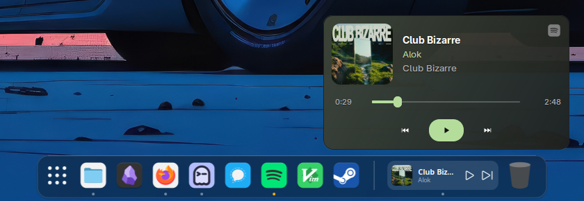
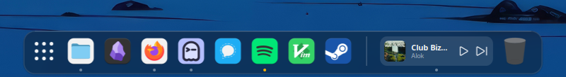
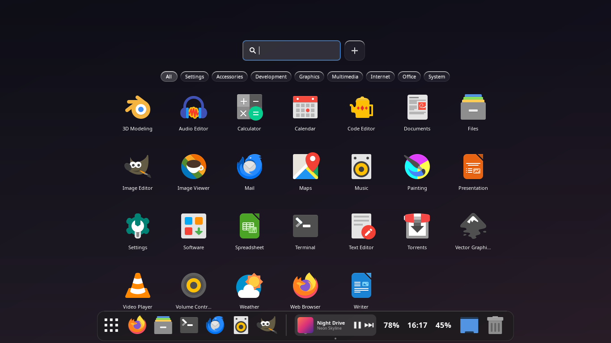
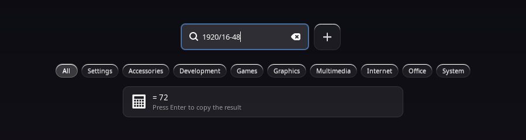

<h1 align="center">
  
  <br>Dokku
</h1>

<p align="center">
  A fast, feature-rich dock built for Linux.
  <br>
  <a href="#about">About</a>
  ·
  <a href="#install">Install</a>
  ·
  <a href="#documentation">Documentation</a>
  ·
  <a href="#contributing">Contributing</a>
</p>

## About

<p align="center">
  
</p>

Dokku is a lightweight dock and full-screen app launcher for Linux. Some docks do the bare minimum, and
others only work as part of one desktop environment. Dokku is a single app that has what you'd
expect from a modern dock: icon magnification, running-app indicators, folders, a now-playing
widget and a launcher with search. 

## Features

- **Dock** with magnification, running-app indicators and Cairo-drawn themes
- **Positioning** on any screen edge, with multi-monitor support and separate settings for each
  monitor
- **Visibility:** auto-hide, and "dodge windows" (hide when a window overlaps)
- **Drag and drop:** reorder icons, or drag a pinned app off the dock to unpin it
- **Folders:** group pinned apps into dock folders
- **Window previews** on hover for apps with several windows
- **Notification badges, progress bars and launch/attention bounce**
- **Recent files** in the right-click menu
- **Mouse shortcuts:** middle-click opens a new window, scrolling switches an app's windows,
  clicking the focused app minimizes it, dropping a file on an icon opens it there, and
  dropping files on the Trash moves them to it
- **Media widget** (MPRIS2) with album art. Rest the pointer on it for a popup with the artist,
  song, album, a seek bar and playback controls. Scroll on it for volume, middle-click to play
  or pause. It follows whichever player is playing, and Settings can list players to ignore
- **Frosted glass** blur via compositor
- **Launcher:** full-screen app grid with search and keyboard navigation. The search box also
  calculates, finds recent files and can search the web
- **Backup:** export, import and reset your settings from the Settings window
- **Plugins:** Trash, Show Desktop and Separator are built in. Clock, Battery and Volume
  widgets are there too, off until you turn them on
- **Global hotkeys** through keybinder

## Install

### Requirements

Dokku needs a few things at runtime.

- `gvfs-backends`: album art in the media widget. Spotify and some other players give an
  `https://` art URL, and GIO fetches those through the GVfs HTTP daemon.
- `libglib2.0-bin`: provides `gio`, which the Trash uses to move files to the trash.
- On Wayland, a compositor that supports `wlr-layer-shell` (sway, labwc, Wayfire, Hyprland and
  KDE Plasma do). GNOME's Mutter doesn't, so Dokku can't draw its dock there. This is a
  compositor protocol, not a package.

### Download

On Debian, Ubuntu and derivatives, download the `.deb` from the
[releases page](https://github.com/yarisgutierrez/Dokku/releases) and install it:

```sh
sudo dpkg -i dokku_*.deb
```

It pulls in the libraries it needs and starts Dokku at login.

### Building from source

Install the build dependencies:

```sh
sudo apt install valac meson ninja-build libgtk-3-dev libwnck-3-dev \
    libgtk-layer-shell-dev libkeybinder-3.0-dev libx11-dev libwayland-dev libwayland-bin
# optional: libatspi2.0-dev
```

Then build and install:

```sh
git clone https://github.com/yarisgutierrez/Dokku.git
cd Dokku
./install.sh
```

By default, this installs for your user under `~/.local/bin`. To install Dokku in another path:

```sh
./install.sh --global              # for everyone, in /usr/local (asks for sudo)
./install.sh --prefix /opt/dokku   # any directory you like
```

Once it's installed, open Dokku from your Applications menu, or run `dokku`. To try it without
installing:

```sh
meson setup build && ninja -C build
./build/src/dokku
```

### Usage

```
dokku                # start the dock
dokku --launcher     # open the app launcher
dokku --settings     # open the settings window
dokku --version      # print the version
```

## Screenshots

The dock:

<p align="center">
  
</p>

The launcher, and its search box doing a calculation:

<p align="center">
  
</p>

<p align="center">
  
</p>

## Documentation

`man dokku` covers the config file, the theme format and where files live. The rest is below.

### Files

| Path | Purpose |
|------|---------|
| `~/.config/dokku/config.ini` | settings, pinned apps, folders, enabled plugins |
| `~/.local/share/dokku/themes/` | themes you install |
| `~/.local/share/dokku/plugins/` | your script plugins |

### X11 and Wayland

Dokku checks which session it's in when it starts. Anything that needs X11 is turned off on
Wayland, and Settings says why next to each option.

| Feature | X11 | Wayland |
|---------|-----|---------|
| Dock, magnification, folders, drag and drop, themes, launcher, Settings | yes | yes |
| Media widget, notification badges | yes | yes |
| Running-app indicators, window list, focus and close | yes | needs `wlr-foreign-toplevel-management` |
| Show Desktop button | yes | needs a compositor that lets clients minimize (labwc does, sway doesn't) |
| Dodge windows | yes | only for maximized or fullscreen windows |
| Attention bounce, Force Close | yes | no |
| Global hotkeys | yes | no, bind a key to `dokku --launcher` in your compositor |
| Frosted glass | yes (picom) | not yet |

sway, labwc, Wayfire and Hyprland provide `wlr-foreign-toplevel-management`.

### Plugins

Settings, Behavior, Dock Items lists the plugins. **Clock**, **Battery** and **Volume** come
with Dokku and are off until you turn them on. The battery widget should remain hidden on a machine
without a battery. The volume widget uses `wpctl` (PipeWire) or `pactl` (PulseAudio): click
mutes, scroll changes the volume.

To write your own, put a folder with a `plugin.ini` in `~/.local/share/dokku/plugins/`, or
install a `.zip` of it from Settings. A widget shows text on its icon:

```ini
[Plugin]
id=uptime
name=Uptime
type=widget
# either a strftime format ...
# format=%H:%M
# ... or a script (a file in this folder, or a command; arguments are fine). Its first
# line goes on the icon and the lines after it become the tooltip.
script=uptime.sh
interval=60                 # seconds between refreshes
command=uptime.sh click     # runs when the widget is clicked
scroll_up=uptime.sh up      # runs on scroll up and scroll down
scroll_down=uptime.sh down
tooltip_format=%A, %e %B    # with format=: the tooltip
hide_when_empty=true        # no output: take no room on the dock
default_enabled=false       # start switched off
```

A plugin with the same `id` as one that ships with Dokku replaces it. From a source tree,
`DOKKU_PLUGIN_DIR=data/plugins ./build/src/dokku` loads the bundled ones.

### Compositor notes

Frosted glass needs a compositor that can blur. Dokku sets these X11 properties so you can
write compositor rules for its windows:

- `_DOKKU_WINDOW` is on every Dokku window (dock, blur backdrop, launcher, settings). Use it to
  turn blur and shadow off for Dokku by default.
- `_DOKKU_BLUR` is only on the capsule-shaped backdrop window. Turn blur on for windows that
  match both `_DOKKU_WINDOW` and `_DOKKU_BLUR`.

`_COMPTON_SHADOW` is set to 0, so picom draws no shadow.

**picom blurs every window once `blur-method` is set.** In picom v13, setting `blur-method`
(`dual_kawase`, for example) turns background blur on for all windows, not just the ones your
rules name. Menus and popups are windows with a transparent margin for their shadow, and the
blur covers the whole window including that margin, so each menu gets a blurred box around it.
The `xrender` backend can't do `dual_kawase`, so it blurs nothing and shows no box. That's why
you only see this with the GL backends. To keep blur on the dock and off menus:

```
rules: ({
  match = "window_type = 'popup_menu' || window_type = 'dropdown_menu' || window_type = 'menu'";
  blur-background = false;
}, {
  match = "_DOKKU_WINDOW@ && _DOKKU_BLUR@";
  blur-background = true;
}, ...)
```

To blur only the dock's backdrop, use a first rule
`{ match = "!_DOKKU_BLUR@"; blur-background = false; }` instead.

**picom and the launcher fade:** on X11 the launcher fades by changing the window's
`_NET_WM_WINDOW_OPACITY`, so the compositor does the blending. If picom has `fading = true`, it
smooths those changes at its own pace, and the launcher fades slowly and then pops out. Turn
picom's fade off for Dokku windows:

```
rules: ({
  match = "_DOKKU_WINDOW@";
  shadow = false;
  blur-background = false;
  fade = false;
}, ...)
```

## Contributing

Issues and pull requests are welcome at <https://github.com/yarisgutierrez/Dokku>.

## License

GPL-3.0, see [LICENSE](LICENSE).
